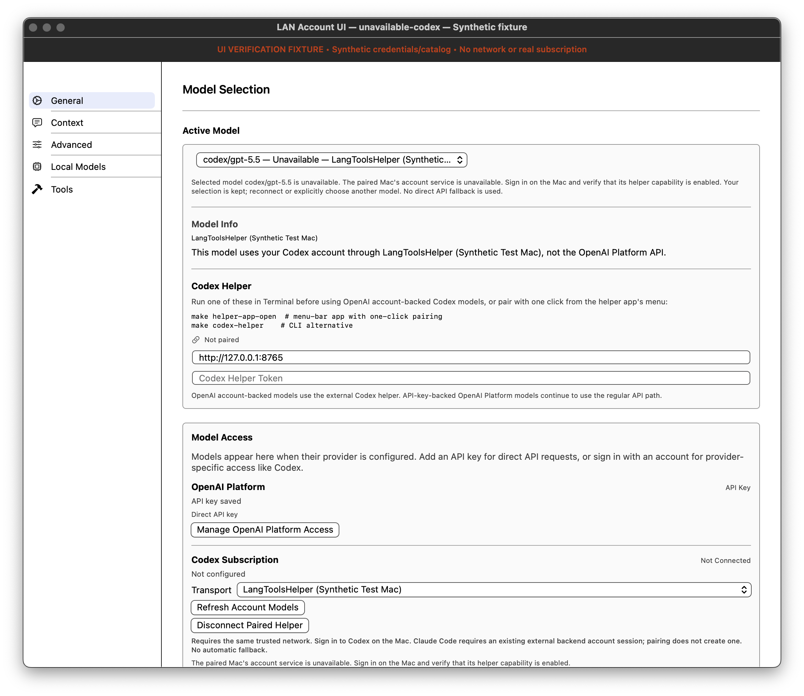
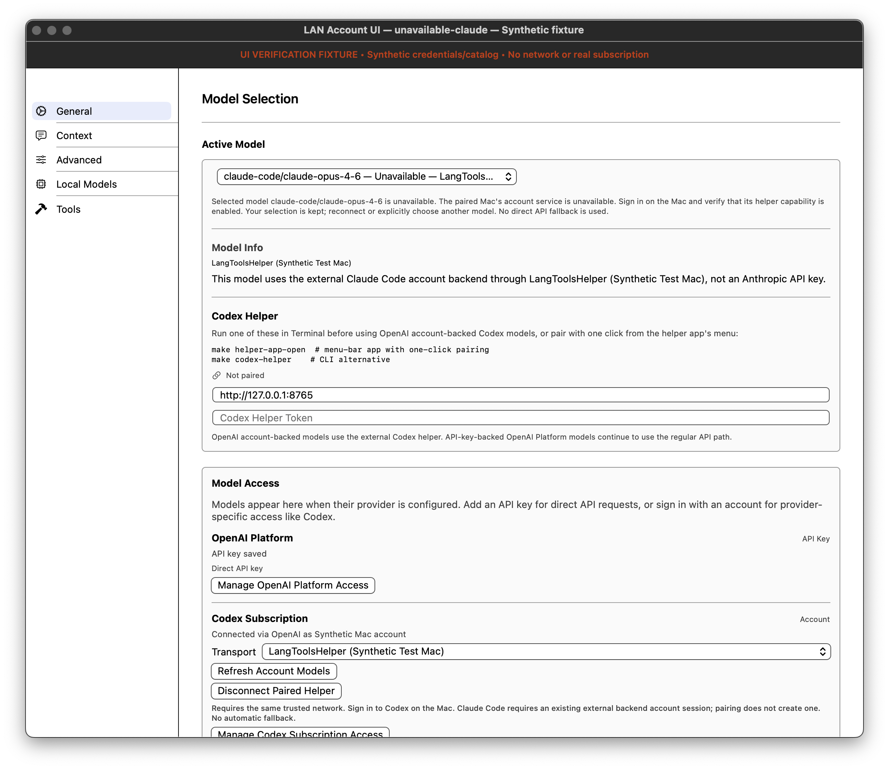
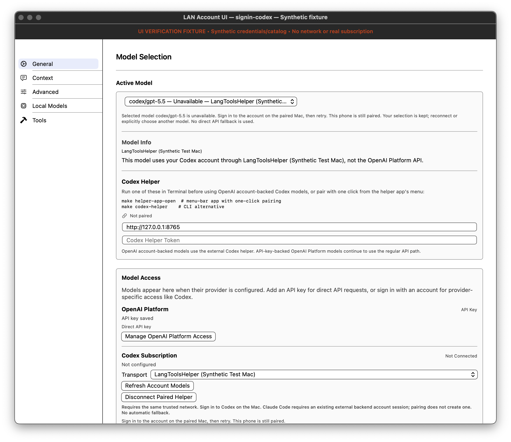
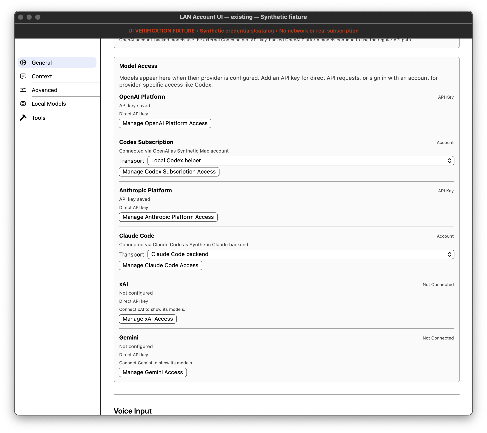
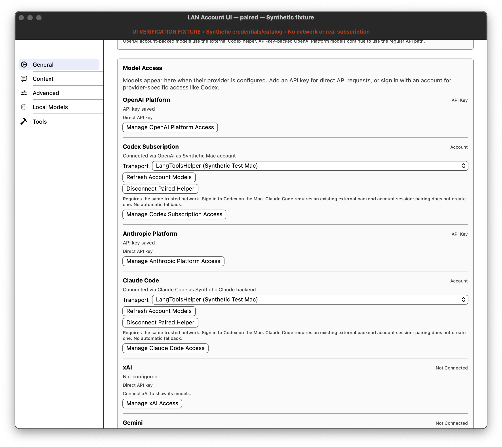
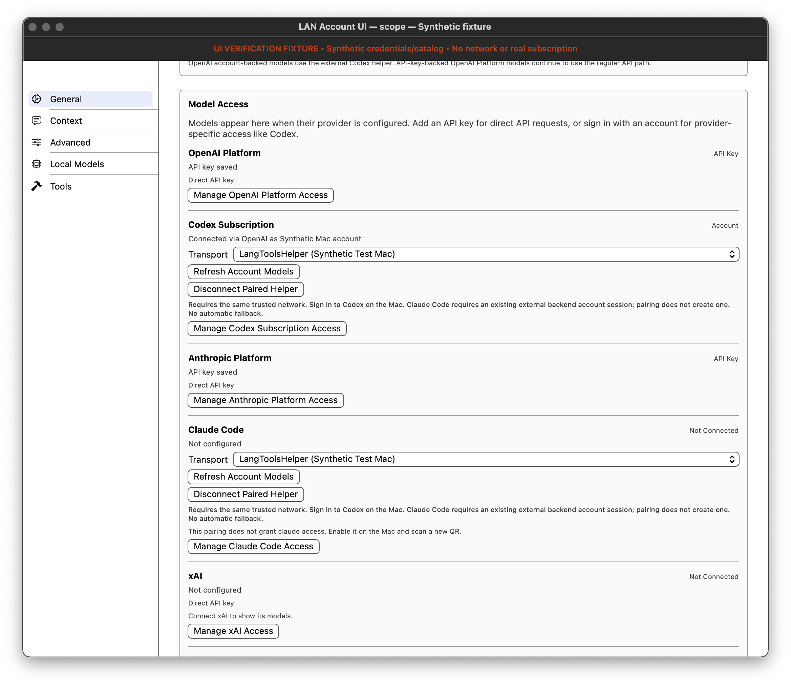
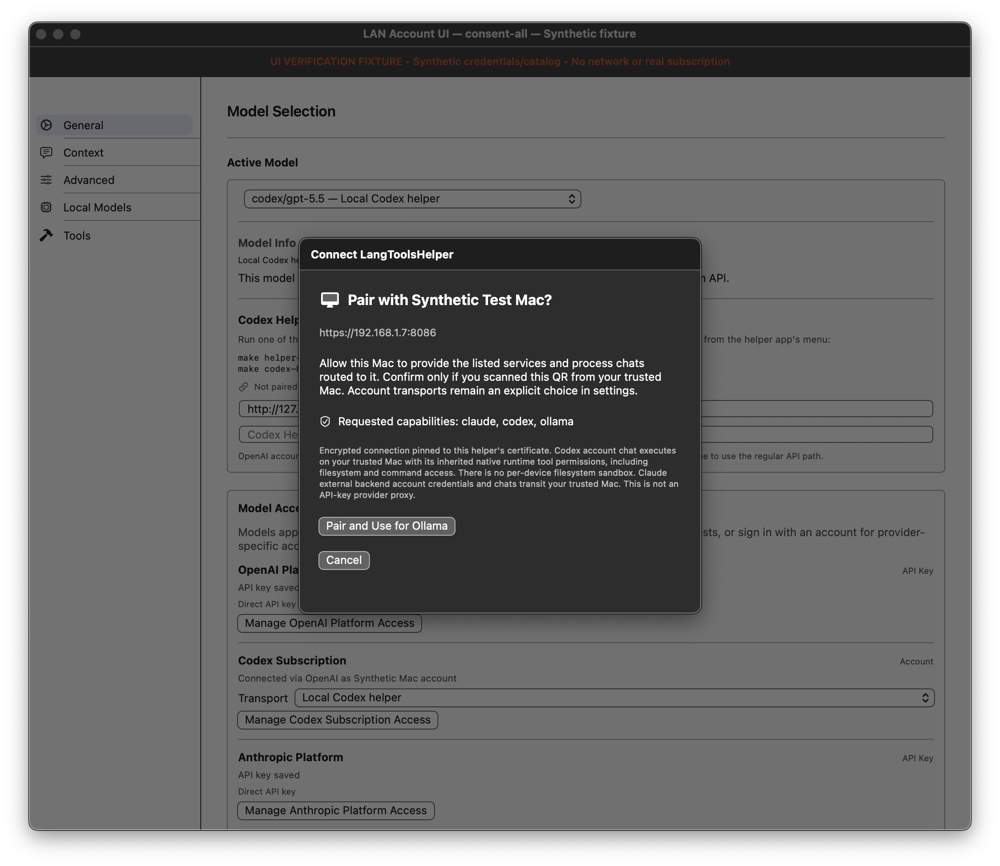
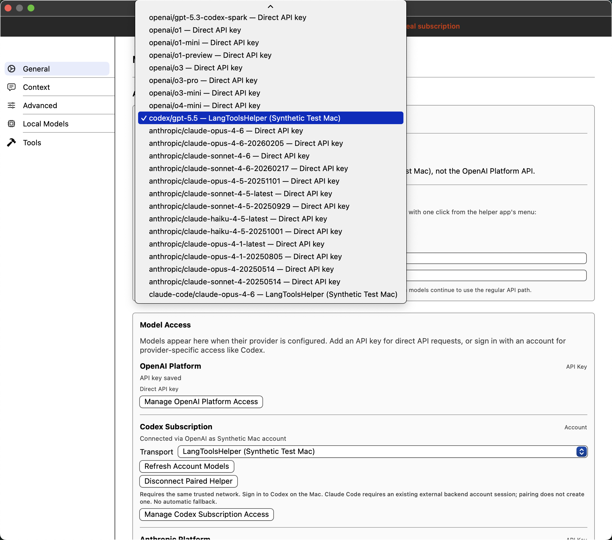
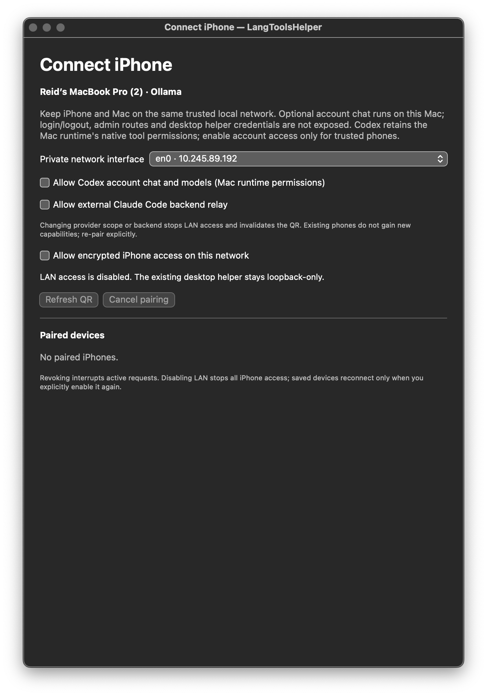
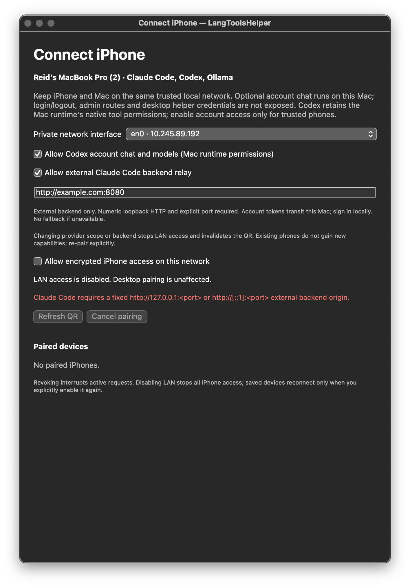

# LangToolsHelper LAN account routing

## Scope and setup

The existing QR-paired, certificate-pinned LAN connection can optionally serve **Codex subscription chat** and an **existing external Claude Code backend**. Direct API-key models remain separate; this is not an API-key proxy for OpenAI, Anthropic, Gemini or xAI.

1. On the trusted Mac, open the helper's **Connect iPhone…** window. Optional Codex/Claude capabilities are **off by default**, as is LAN access on launch.
2. For Codex, sign in on the Mac using the existing Codex helper. For Claude, configure an already-running external backend using a numeric-loopback HTTP origin with an explicit port. The helper does not implement a native Claude login/runtime.
3. Select the desired capabilities, enable LAN on the selected private IPv4 interface, and scan a fresh QR. Confirm the Mac and the complete listed scope. Changing scope/backend stops LAN and invalidates pending pairing; old devices never acquire added capabilities automatically.
4. In app **Settings → Model Access**, explicitly select **LangToolsHelper (Mac name)** for each desired account provider, then refresh account models. Pairing alone does not change account routes. Claude still requires its external backend account session; Codex does not require phone OAuth credentials.
5. Model picker/info and provider settings distinguish **Direct API key**, **Local Codex helper**, **Claude Code backend**, and **LangToolsHelper (Mac name)**. Direct Ollama remains an explicit alternative.

Missing grants, unavailable helper/backend, pin changes and revocation fail closed. There is no automatic API-key or loopback fallback. Opening/saving Settings preserves a selected paired-account model through relaunch, pending/failed discovery and disconnect, even when direct API keys are configured. The picker retains an explicitly **Unavailable** entry and explains that reconnecting or choosing a replacement is required. To change route, select it explicitly. Captured requests retain their original immutable authorization/catalog/route and pinned-session lease; changing selection affects future requests. Disconnect clears future helper access/catalogs; Mac-side revoke/disable also interrupts active work.

Codex Mac-account authentication failures use a sanitized **503** response with `X-LangTools-Account-Error: sign_in_required`, not the device-authentication 401/403 path. The app asks you to sign in on the paired Mac and retry, without replacing the device credential or requiring re-pairing. Streaming headers wait for the first runtime event so an initial authentication failure can use this response; failures after output abort without a fabricated completion.

## Security boundaries

- Device tokens authorize only the intersection of saved grants and enabled services. Original Ollama-only grants remain unchanged. v1 pairing links keep their six-key format and implicit Ollama scope; v2 links explicitly bind a canonical capability set to consent, redemption and initial authenticated health.
- Subsequent discovery/reconnect permits enabled-capability narrowing, rejects grant expansion, and requires the requested provider. Catalog results are scoped to helper/provider/session revision; stale discovery cannot populate a different route.
- TLS uses the exact QR-pinned certificate identity and rejects redirects. Arbitrary persisted URLs cannot become paired account destinations. The existing strict loopback configuration gate is unchanged.
- Codex LAN permits model discovery, read-only status, chat and device-owned conversation deletion. Login/logout and administration remain local. Conversation ownership prevents another device from deleting desktop/other-device conversation state.
- **Codex retains the Mac runtime's native tool permissions, including filesystem and command execution within the existing runtime policy. This is not per-device filesystem isolation. Pair only trusted phones.** Both Mac opt-in and app consent disclose this boundary. Cancellation is bridged across queued factory calls, producer creation/handoff and upstream dispatch; already-dispatched turns are interrupted and joined before releasing the connection slot.
- Claude uses only the configured fixed loopback backend. Its separate account credential transits the trusted Mac and becomes upstream authorization; the device bearer and desktop helper token are never forwarded. Upstream redirects/errors are rejected/sanitized. There is no provider-account administration on LAN.
- Existing request/response limits, per-record bounds, connection limits and read/send/route deadlines also apply to optional services. Failed streaming responses do not fabricate completion events.

See [helper README](../cli/README.md#optional-account-capabilities) for routes and [Ollama verification history](helper-ollama-verification.md) for prior acceptance evidence.

## Current verification (2026-10-09–23)

All results below are local runs, not a claim about remote CI or live subscriptions. Root/app/build/UI results are from October 9; the helper filter was rerun on October 13 after the test/fixture-only cold-start observation adjustment. The October 19–20 observer work and narrowed client-test verification are recorded separately below and did not change production or UI code.

| Verification | Result |
|---|---|
| Root `swift test --jobs 2 --no-parallel` | 378 executed, 5 skipped, zero failures (373 passed) |
| Shared `HelperLinkTests` | 11 passed, zero skips/failures; included in root total |
| Updated bounded helper CI filter (October 13) | 108 passed, zero skips/failures; includes 24 client tests |
| Updated bounded app CI filter | 184 passed, zero skips/failures |
| App filter plus upstream checkbox regression | 185 passed, zero skips/failures |
| Actual Chat module macOS build and current fixture relink | Passed |
| Independent code/security re-review | No actionable findings in selection preservation and account-authentication fixes |
| Frozen-resolution iOS simulator build | Exit 65 at normal `JSONMacroPlugin` changed-revision approval, before app compilation/UI tests |

The October 10 focused cleanup and retained-workspace tests both passed, followed by 20 consecutive successful idle-cleanup repetitions and the 103-test helper filter above. Cleanup polling has a five-second monotonic deadline and still asserts workspace removal **before shutdown**; the retained-workspace case verifies timeout without false success. The scoped test-only review found no actionable issues. Production timing and UI are unchanged.

The branch includes main merge `0d17fa90`. Remote CI at `323222c5` had six successful checks, one helper-test failure (workspace still present after a fixed 100 ms sleep), and two intentionally skipped cloud checks. That affected test/runtime code predated these account fixes; scheduler delay is plausible, not proven. The bounded assertion adjustment addresses this CI finding; subsequent remote checks are tracked on the PR, not claimed here. The helper-control screenshots below were recorded on October 8; their UI implementation is unchanged.

### October 13 cold-start observation verification

The cold-start cancellation regression now records resolver/fixture phases and explicit success/error before cancellation and shutdown, using an isolated Python fixture with protocol-only NDJSON stdout. Pre-cancelled input must produce `CancellationError`, zero resolver calls and no fixture evidence; recovery must succeed with the exact initialization/barrier transcript. A dedicated error case verifies that request completion is not mistaken for success.

Fresh normal startup and pre-cancel/recovery both succeeded with controlled 3.25-second initialization-reply holds and separate 3.25-second fixture-entry holds. Reinstating the rejected three-second phase predicates in a temporary **test-only** probe produced four expected assertion failures across the two entry-delay cases, despite successful barriers; the probe was removed and restored source rebuilt. This establishes a test observation defect, **not the cause of the historical CI delay**. Client initialization/request deadlines remain eight/two seconds. One absolute 13-second test observer budget includes a named three-second resolution/launch/observation allowance; individual phase observations are diagnostic, not premature three-second rejection gates. Cleanup has a separate bounded wait.

Latest verification: **20/20** serial cancellation-regression repetitions, **2/2** dedicated entry-delay tests and **108/108** tests in the exact helper filter. Independent scoped review found no actionable issues in the corrected test/fixture changes. Production and UI are unchanged.

**Unresolved verification caveat:** standalone client-suite runs also failed in unchanged cases. An earlier run passed 20/22 (oversized-line subscription timeout and unexpected restart count); the latest standalone run passed 22/24 with unexpected process exits in `testInitializationUsesSeparateTimeoutFromOperationalRequests` and `testProcessExitIsReportedAndNextRequestRestartsServer`. The later helper-filter run passed all 24 client tests, but does not explain or clear those failures. No unrelated test/runtime fix was made. At pushed head `0af9ab68`, remote helper CI still failed the original cold-start test's three-second expectation plus missing-log error; both idle regressions and all 16 provider tests passed. Fresh remote checks are required for this adjustment and tracked on the PR, not inferred from local success.

### October 19–20 observer and client-suite verification

A temporary debug-only metadata observer was built to locate where the oversized-output path loses work. The first version invalidated its own trace (contention loss), so that run proves nothing and is retained only as a failed experiment. A corrected recorder — fixed typed slots, checked zero-based atomic reservations, full-width seal, failure flags published before writer completion, and quiescent-only snapshot reads — passed independent code and security review before a single run. That run produced a valid 558-event window: every read, yield, delivery and consume stage carried the same 1,048,577 unterminated bytes after the operational timer, the matching-generation buffer reached the limit plus one, `invalidResponse` was thrown, and generation-2 recovery succeeded with exactly two launches. Initialization completed 5.519 s after its timer, after the intentionally prestarted five-second waiter expired. All temporary instrumentation was then removed by exact owned segments back to the pre-instrumentation hashes, and the restored source rebuilt without executing tests.

Those observations describe one instrumented invocation. They do **not** reproduce or explain the earlier 20/22 and 22/24 failures, and they say nothing about an OS read-size policy, observer overhead, or production stability.

Verification then ran locally against the restored source: **20/20** serial repetitions each of the initialization-timeout, process-restart and oversized-unterminated tests, **5/5** each of three ordered pairs, every dedicated control/diagnostic case, and the full 27-case client suite (twice, including once without `PR77_TEST_EVIDENCE` to match CI). All green, with no production change. Independent review rejected publishing the entire diagnostic scaffold — one test froze the startup-producing-getter hazard as an accepted contract, and the prestarted-waiter ordering assertion is scheduler-sensitive — so only a hardened finite flush-then-exit test was kept: it decodes just newline-terminated fixture records and starts shutdown independently of observation-task joins with an explicit bounded-cleanup failure. Final check of that narrowed file: **20/20** repetitions plus the three affected tests and two full client suites, all green. The historical failures remain unexplained and no production fix is implied.

### October 22 exit-status attribution fix

Remote CI then reproduced the historical "unexpected process exit" class rather than clearing it: at head `00ab9133`, `helper-mobile-tests` failed **2/2 attempts** (first run and one rerun) on `testProcessExitIsReportedAndNextRequestRestartsServer` with `Expected exited error, got transport("Codex app-server closed stdout.")`. The same code passed 20/20 locally, so this is an ordering race the runner reliably hits.

Cause: `stdoutClosed` classified EOF solely through `process.isRunning`. When the stdout EOF was observed before the reaper flipped that flag, pending requests resumed with a transport failure and the exit status was lost; the later termination callback could not correct an already-resumed error.

The fix waits a **bounded grace** after EOF before classifying it: an absolute 250 ms `ContinuousClock` deadline, sleeping at most 10 ms at a time, then attributing `.exited(status:stderr:)` through the existing termination path. A child that closes stdout and keeps running still fails closed once the grace expires. The grace task is generation-scoped, detached from caller cancellation, and joined by `invalidateProcessAndWait` so teardown cannot race it. Production timers, ownership and buffering are unchanged.

`testStdoutCloseBeforeProcessReapingAttributesExitStatus` covers it with a fixture that flushes and closes OS descriptor 1 while still alive, waits 150 ms, then exits 7. Against the unfixed runtime that test fails **3/3** with the exact CI error; with the fix it passes, and post-correction verification was **63/63** green (20/20 new test, 20/20 restart, 20/20 oversized-unterminated, the separate-timeout case, and two full client suites including one without `PR77_TEST_EVIDENCE`). Independent code and security review both returned PASS.

Fresh remote CI at `10e12adf` then passed **eight checks with two intentional cloud skips and no failures**, including `helper-mobile-tests` — the job that failed 2/2 at `00ab9133` — plus `app-helper-tests`, `extended-tests`, `performance-tests`, `linux-build` and the review job.

The fix does not explain the separate oversized request-timeout reds or the historical `0af9ab68` cold-start failure, and a bounded grace is not a strict wall-clock guarantee under actor scheduling contention.

Main advanced sixteen commits while the fix was in progress; they were merged as `10e12adf` with conflicts resolved in `ProviderAccessManager` and `ChatSettingsView`. The merged tree builds, the local app CI filter passes **195/195**, and the client suite passes **26/26**.

Reproduce the focused checks:

```sh
swift test --jobs 2 --no-parallel
swift test --package-path cli --jobs 2 --no-parallel \
  --filter 'MobileHelperTests|MobilePairingControllerTests|MobileProviderTests|MobileCodexContainmentTests|CodexRuntimeServiceFocusedTests|CodexAppServer'
swift test --package-path Apps/LangTools --jobs 2 --no-parallel \
  --filter 'PairedAccountSelectionRegressionTests|PairedAccountTransportTests|NetworkClientAuthTests|MobileHelper|OllamaEndpoint|ProviderAccessManagerTests|ProviderAccessRefreshRegressionTests|OllamaSettingsErrorRegressionTests|ChatGenerationSettingsTests|ModelGenerationCapabilitiesTests|ChatModelSourceTests/testProxyOllamaCatalogAndTitlesIgnoreDirectEndpointAvailability|ChatModelSourceTests/testDefaultAndDirectCatalogUseExistingProviderAccessManager'
```

Coverage includes capability opt-in/old grants, token separation, real pinned TLS data/stream/discovery, wrong pins and redirects, revocation/disconnect, stale catalog races, captured route/session ownership, scope narrowing/expansion, canonical v2 consent, queued/pre-dispatch cancellation and joined after-dispatch cleanup. New regressions exercise actual Settings load/save with direct keys present across relaunch, pending/failed discovery, missing grants and disconnect, including zero direct requests. Fake Codex runtime and pinned-TLS cases distinguish Mac sign-in from device revocation, recover without re-pairing and reject successful completion after a post-delta authentication failure. CI reports LAN-dependent skips rather than treating them as physical acceptance.

## Current rendered UI evidence

These are actual current macOS SwiftUI views rendered by a disposable `NSHostingView` fixture, **not copied/recreated UI**. The settings/model/consent fixture uses visibly labeled synthetic credentials/catalogs and deny-network transport; no real provider/account requests or QR redemption occurred. Helper controls use an ephemeral identity/device store in the existing screenshot test. Every capture was inspected. Settings, picker and consent captures were regenerated from current source on October 9; unavailable-selection and Mac sign-in fixtures additionally save settings and verify that the account model remains selected. No active QR, reusable token or private key is shown.

| Unavailable Codex selection retained | Unavailable Claude selection retained | Mac sign-in needed; phone still paired |
|---|---|---|
|  |  |  |

[Pending discovery](helper-lan-providers-screenshots/mac-pending-codex.png) · [Disconnected helper](helper-lan-providers-screenshots/mac-disconnected-codex.png)

| Existing account routes/direct APIs | Explicit paired account routes | Missing Claude grant |
|---|---|---|
|  |  |  |

| Capability-specific consent | Actual expanded model picker |
|---|---|
|  |  |

[Codex-only consent](helper-lan-providers-screenshots/mac-consent-codex.png) · [Ollama-only consent](helper-lan-providers-screenshots/mac-consent-ollama.png)

| Optional providers default off | Invalid external backend rejected |
|---|---|
|  |  |

### Frozen-resolution iOS retry

```sh
xcodebuild -project Apps/LangTools/LangTools.xcodeproj -scheme LangToolsApp \
  -configuration Debug -sdk iphonesimulator \
  -destination 'generic/platform=iOS Simulator' \
  -derivedDataPath /tmp/pr77-fixes-ios-derived \
  -clonedSourcePackagesDirPath /tmp/pr77-pass1-ios-derived/SourcePackages \
  -disableAutomaticPackageResolution -onlyUsePackageVersionsFromResolvedFile \
  -skipPackageUpdates \
  LANGTOOLS_APP_BUNDLE_IDENTIFIER=com.reidchatham.LangTools-Example-UIFixture \
  CODE_SIGNING_ALLOWED=NO build
```

The cloned-package path is a local pinned cache, not a portable prerequisite. The fixture bundle identifier alone does not suppress live startup on iOS; this command was build-only. No simulator was booted or app installed/launched.

## Unresolved acceptance blockers

- **Current iOS layout/build/signature and simulator UI verification:** the October 9 retry without the outer sandbox wrapper, using frozen-resolution flags and cached JSON.swift revision `498270c44bb80c5cf5b8de8727ceb030f95c0777`, failed at `ComputeTargetDependencyGraph`: “Macro ‘JSONMacroPlugin’ from package ‘JSON.swift’ was changed since a previous approval and must be enabled before it can be used.” Use Xcode's normal **Trust & Enable** confirmation for the reviewed resolved macro, then rerun the build and UI checks. No macro-validation bypass, trust metadata/dependency/lockfile change, or stale simulator binary was used on this retry. The built-in app fixture is macOS-only; an iOS capture must independently establish safe fixture startup before launch.
- **Live account end-to-end:** neither physical-phone Codex chat nor the external Claude backend/session path was exercised against a real subscription in this work. Active QR scanning for added grants remains unverified.
- **Physical Ollama:** the owner reported pairing/reconnect/revocation on an iPhone for the existing Ollama path only. This does not establish new account capabilities, shutdown/interface-change checks or current screenshots.
- **CI/test stability:** the latest bounded helper filter passed, but standalone client-suite failures above remain unexplained and remote helper CI at `0af9ab68` is red. A later local pass does not clear earlier failures; inspect fresh remote checks before claiming CI success.
- **Whole app/CLI suites:** the historical whole-app/CLI live-account, Keychain and external-service blockers were not reclassified as passed.
- **Presentation limits:** a long selected Claude picker title truncates at the existing width; full identity is visible in model info/expanded menu. The separate desktop Codex pairing section can say “Not paired” while LAN account routing is paired; it reflects desktop pairing, not the LAN route.

Keep the PR **draft** until current iOS and live account/physical-device acceptance are explicitly resolved. macOS fixture screenshots verify presentation, not connectivity or iOS layout.
