# Shared Ollama settings integration evidence

## 2026-10-29 — Synchronization with current main

Merged main `8da5cbc1b0653c2c8a6cdad9683e24c9cb6eff50` into the published `37d6c32` source. Resolved eight file conflicts by retaining independent local/Cloud model identities and Cloud transport refusal alongside main's Apple Intelligence and compatible-provider routes. The combined provider manager retains Cloud eligibility and explicit selections, supports compatible catalogs, and preserves main's rule against silently falling back to Apple. The settings model retains transport-aware capabilities, missing-selection presentation, and main's picker search/grouping.

Added three in-memory regressions for combined provider availability, explicit Cloud/local retention, and fallback behavior; updated the existing catalog enumeration assertions to include inherited providers. App compilation and test-bundle compilation passed. Guarded XCTest selections passed **71 tests, zero failures and zero skips**: 52 merge/endpoint/routing/refresh tests, 15 generation/Apple request-mapping tests, and four settings-capability/picker tests. Runtime execution used a minimal environment without production credentials, temporary HOME/preferences, denial of all four SecItem operations, and network denial. Guard activation and a separate denial probe were verified; attempted Keychain operations were denied, not evidence of no attempted calls.

This is bounded source-integration verification. Full-suite, live provider, native app/UI, current screenshots, and authenticated operational acceptance were not rerun. Historical visuals below remain dated evidence. Current-head hosted CI must be checked after publication; this synchronization does not establish merge readiness or authorize deployment.

Actual public `ChatSettingsView` rendered in a consuming host with isolated synthetic fixtures. These images show only shared package views and fake/default model state—not credentials, standalone LangTools transport, or live providers.

## Current shared Chat status — 2026-10-22

Recorded public [PR #67](https://github.com/rchatham/LangTools.swift/pull/67) CI
baseline at published `6994d3d`: **7 successes / 2 Cloud skips**. New-head CI and
publication receipts are separate from this prepublication verification checkpoint;
current source does not inherit historical checks. The PR remains draft, unmerged
and not merge-ready.

Shared settings now resolve effective generation capabilities through a
default-compatible host seam. Unsupported Cloud Top K is inactive without deleting
the saved value for a capable Direct transport. Missing selected local/Cloud models
retain a labeled unavailable picker entry across ready/loading/error catalogs;
retention is presentation only, not catalog expansion or dispatch authorization.
Public Model semantics remain unchanged. Original macOS fixture-management action
guards and disabled modifiers are retained; the fixture environment is nil outside
macOS.

Fresh standalone build-tests after guard restoration **PASS (10.18s)**. The **five
selected shared Chat capability/picker methods** and **two shared-view render methods**
passed with **0 failures, 0 skips and no timeouts**. Runs used four-SecItem denial,
outer network denial, isolated HOME, scrubbed environment and a process watchdog.
These bounded selections are not full-suite, credential-positive/helper TLS/account/
live-provider or interactive workflow proof. Historical **73** shared Chat and **335**
provider results below are not current reruns. Host package compilation does not
compile native UI assertions; no new native compilation occurred. Current iOS
outcomes and screenshots remain missing; native execution is stopped, with host-driver
guard activation/environment nonforwarding unestablished. No native permission is implied.

## Current synthetic shared-view evidence — 2026-10-22

All eight images were individually visually inspected and byte-verified on copying.
Unavailable labels are complete across ready/loading/failed states, with distinct
local versus Cloud explanations. Direct shows saved Top K **37**; proxy controls show
Top K inactive with its saved value preserved. No secrets, private views, operational
identifiers or host paths are visible. These are own-NSWindow view bitmaps, **not
desktop screenshots, interactive workflows or native iOS verification**.

| Local missing: ready | Loading | Failed |
|---|---|---|
| 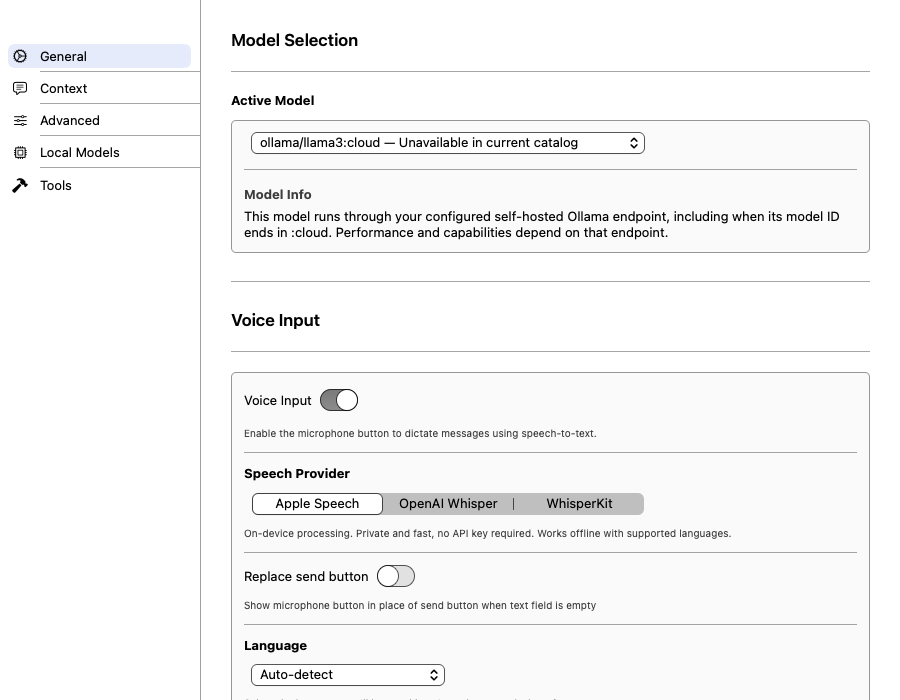 | 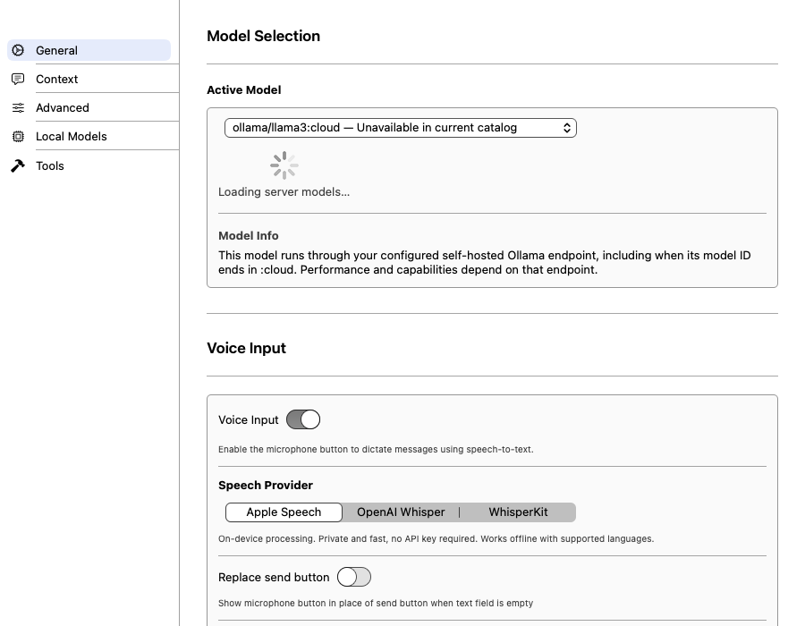 | 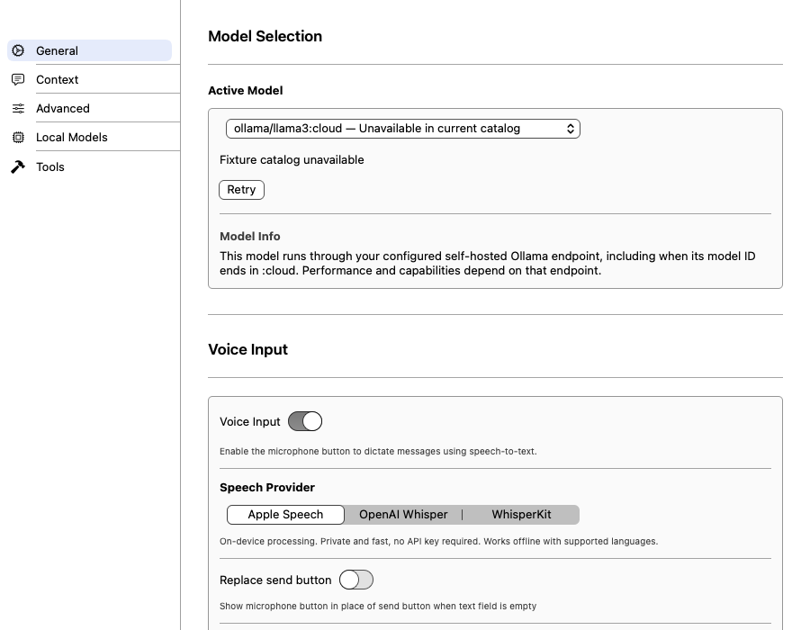 |

| Cloud missing: ready | Loading | Failed |
|---|---|---|
| 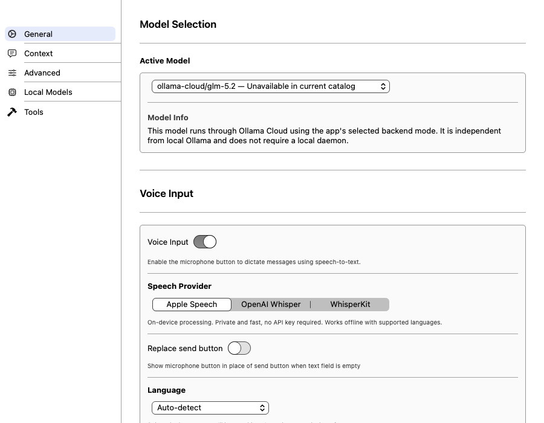 | 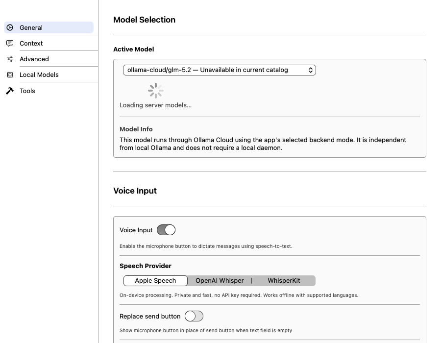 | 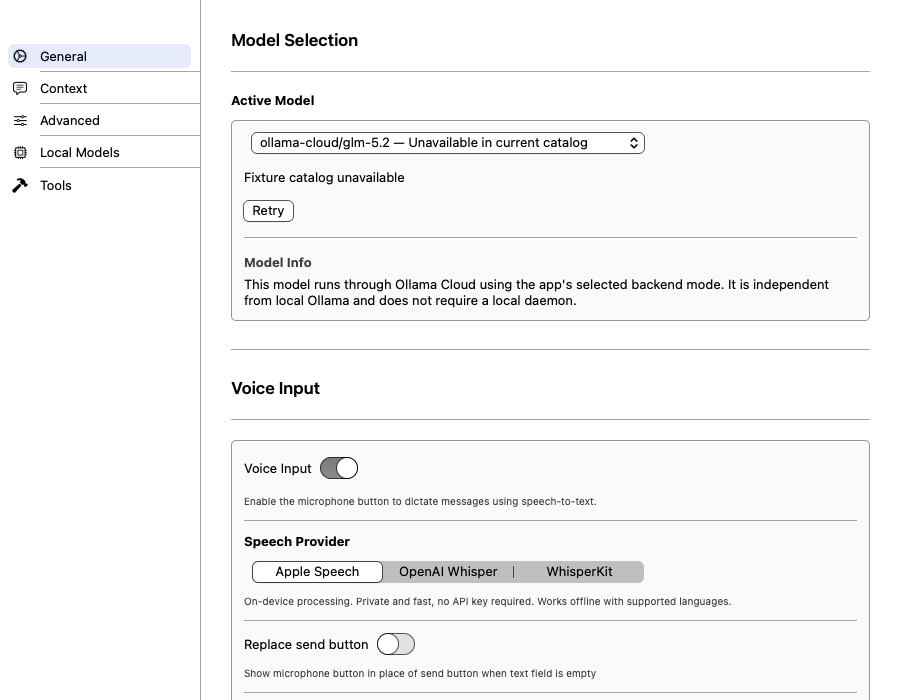 |

| Direct: saved Top K 37 | Proxy: inactive, value retained |
|---|---|
| 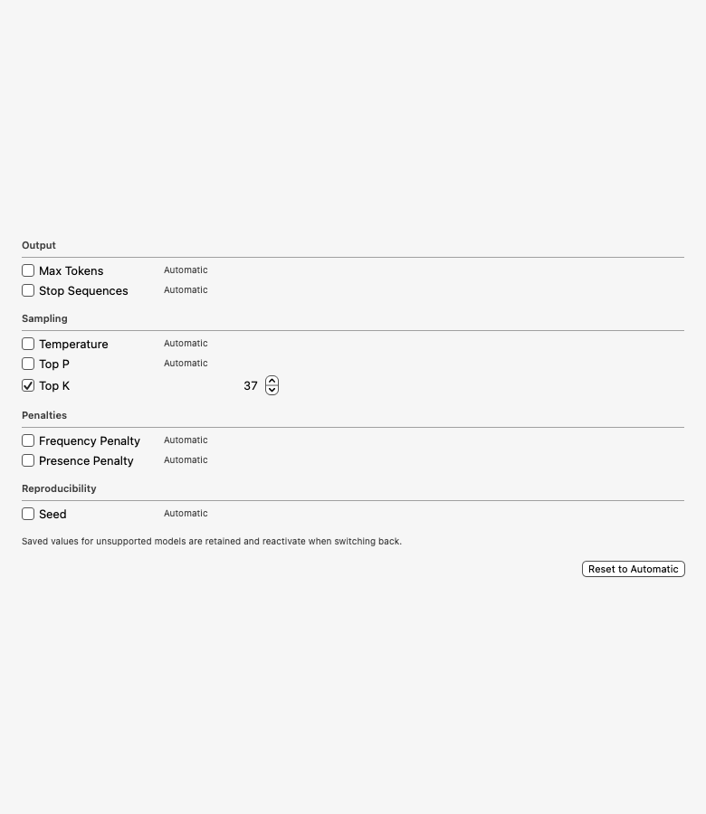 | 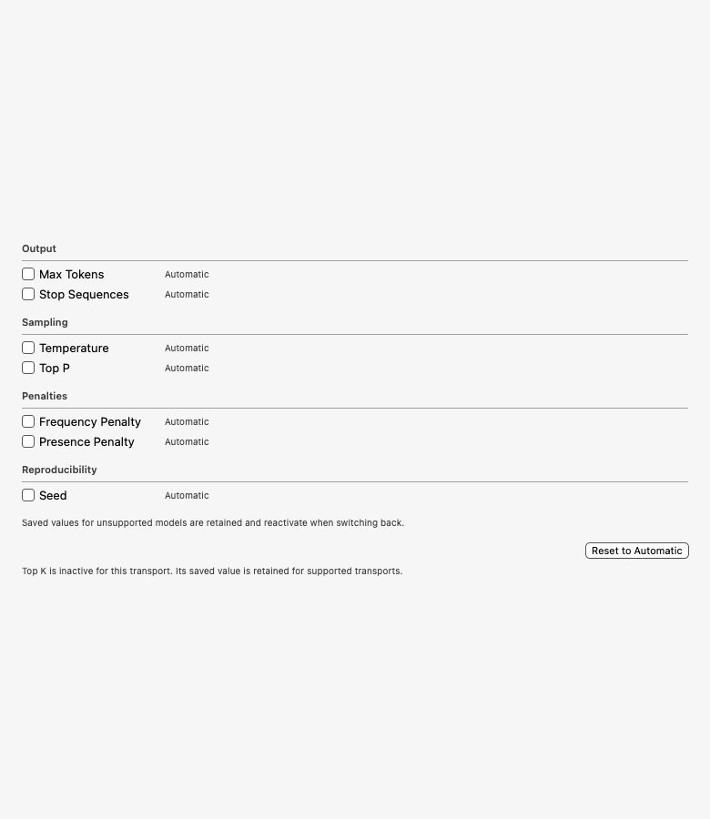 |

## Historical macOS rendered evidence — 2026-10-13, published at `6994d3d`

These three images depict the previous published revision, not the new settings
changes above. They show actual synthetic NSHostingView bitmaps captured using the
renderer’s own briefly visible NSWindows, closed afterward: **not desktop
screenshots, offscreen-only rendering, interactive host app workflows or standalone
LangTools transport proof**. Only shared views and fake/default state are included.
These historical image files are unchanged; the current captures use separate filenames above.

| Local daemon | Local `:cloud` ID | Distinct Cloud |
|---|---|---|
| [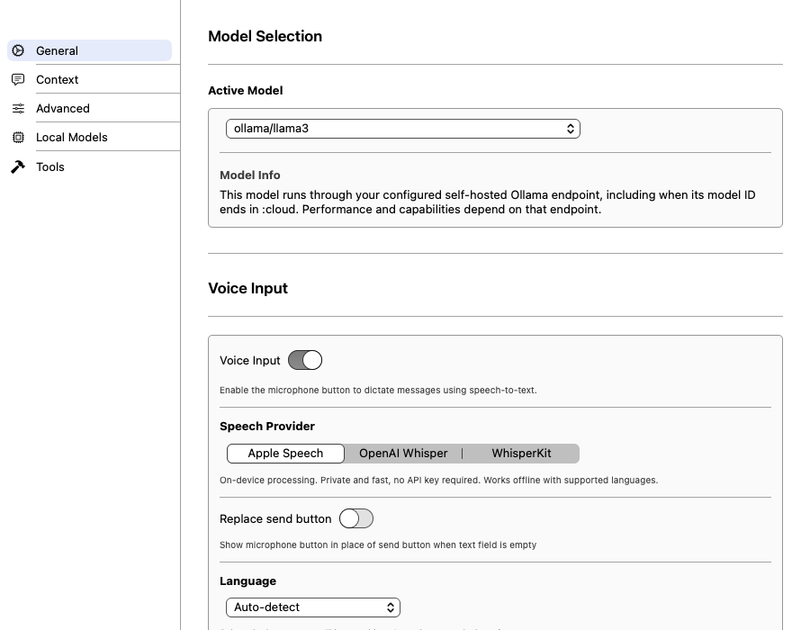](shared-settings-macos.png) |  | [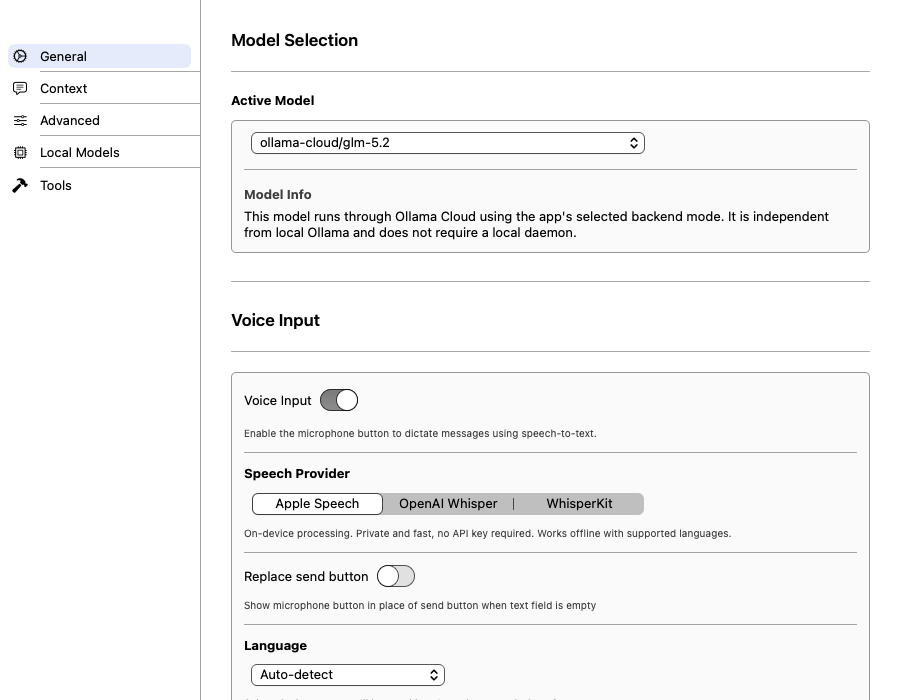](shared-settings-macos-cloud.png) |

Captions: `ollama/llama3` has the local explanation; `ollama/llama3:cloud` retains
that local explanation and route; `ollama-cloud/glm-5.2` has an independent Cloud
description. Fake/default state only, not current live-provider availability.

## Historical results / gates — 2026-10-14 (superseded)

These receipts predate the current source pass. The subsequent publication at
`6994d3d` includes target merge `514f071`; the earlier `cf15ec9` draft is historical.
- Implemented source fixes: HTTPS synthetic CI fixture without weakening endpoint
  policy; all THREE approved P3 fixes—DEBUG session read/swap locking with invalidation
  outside the lock, explicit local/Cloud preference retention using one eligibility
  snapshot, and concrete injected Cloud catalog isolation preserving production
  defaults/key/schema/API. Quiescence remains required; not active-request lifecycle
  or TSan proof. Bounded source/security review PASS is not whole-PR approval.
- Shared Chat **73 selected / 0 failures**. ProviderAccess is 14 selected of 23; nine
  credential-dependent methods were not executed, and two negative/override passes
  lack positive saved-key prerequisites. The exact CI fixture overlaps this total.
- Provider root **335 selected / 0 failures / 5 skipped**, including earlier 33
  callback tests (not additive). Both AppleSpeech classes, whole WhisperKit class and
  six HelperLink cases are excluded under TCC/no-download/no-socket boundaries.
  Full account, credential persistence, socket/helper TLS, live-provider and database
  behavior are not established by this selection.
- Consuming-host **macOS AND iOS Debug and Release app compilation PASS** with normal
  validation and narrow isolated macro approval. Compiler-only permission does not
  guarantee zero compiler network. Fresh UI build-for-testing **PASS in 48.075s**;
  initial timeout with UNKNOWN compiler exit remains a separate failed/incomplete
  attempt, not green. Independent iOS **Release fixture-exclusion PASS** uses fresh
  Debug-positive/Release-absent symbols/strings and compiler flags/source guards.
- All **14 fixture cases compiled, NOT executed**. The **28 total runtime outcomes**
  (14 on compact and 14 on large) and current iOS images remain missing. New isolated
  QA devices were recorded available/eligible but **never booted**. Runtime signature
  re-verification passed after an initial seal failure and normal re-import;
  stale unusable-image metadata remains, so full runtime usability is not claimed.
- Native execution stopped after a contained host driver metadata probe aborted with
  **SIGABRT (-6), no output and no guard activation marker**. Cause is unestablished;
  neither a source defect nor actual credential access is proved. Effective simulator
  fixture group was statically resolved from `__TEXT/__entitlements`; no actual
  signing occurred. Accepted simulator framework-egress residual does not waive host
  guards. No native continuation is authorized by this documentation pass.
- Historical CI at `cf15ec9`: six successes, one app-helper failure, two Cloud
  skips. Preserve that failure as an earlier receipt; later published `6994d3d`
  has seven successes and two Cloud skips. Neither establishes checks for the
  2026-10-22 source pass at this verification checkpoint.

Existing receipts only; this offline documentation reconciliation ran no tests/builds,
probes or publication. Public evidence is limited to shared Chat scope; operational
identifiers and host-only evidence are not included.

## Historical macOS source-remediation evidence — 2026-10-08

The older three images remain identifiable at published `cf15ec9`; filenames above
hold the historical 2026-10-13 renders published at `6994d3d`, not these older captures:
[local](https://github.com/rchatham/LangTools.swift/blob/cf15ec9c460255ef4b7226ddc642cf3f660625c8/docs/ollama-integration/shared-settings-macos.png),
[local cloud tag](https://github.com/rchatham/LangTools.swift/blob/cf15ec9c460255ef4b7226ddc642cf3f660625c8/docs/ollama-integration/shared-settings-macos-local-cloud-tag.png),
[Cloud](https://github.com/rchatham/LangTools.swift/blob/cf15ec9c460255ef4b7226ddc642cf3f660625c8/docs/ollama-integration/shared-settings-macos-cloud.png).

Earlier results: child **71 / 0**, provider root **375 / 0** (5 skipped),
Mac render/probe **6 / 0**. Those guarded runs
covered endpoint/cache/currentness/helper/settings/native fixtures and callbacks;
real-Keychain roundtrip was retained but excluded after guard denial. Full Chat/
account/helper and live socket/TLS proof were not claimed. At that checkpoint,
Xcode's nested manifest sandbox blocked app-target compilation; subsequent current
macOS and iOS builds resolved compilation; current iOS runtime/visual gates remain.

## Historical iOS evidence — not current source verification

| Compact iOS (pre-merge) | Large iOS (pre-merge) |
|---|---|
| [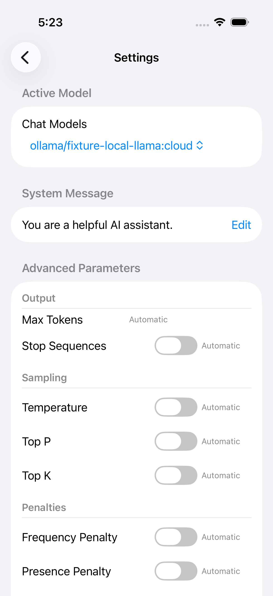](shared-settings-ios-compact.png) | [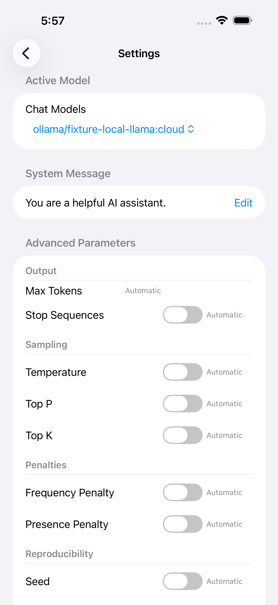](shared-settings-ios-large.png) |

These files remain pre-merge captures. Historical native fixtures passed 12 cases per viewport; a later startup correction passed three affected compact flows without a full rerun. Upstream settings/helper UI changed afterward. Fresh repaired-head compact/large inspection and screenshots remain a merge-readiness blocker; unchanged files do not prove visual equivalence.

Standalone Chat refuses Cloud completion/stream/agents without a host Cloud-capable transport; a consuming application must supply that integration. Snapshot exposes no direct raw helper credential/lease/session getter, but returned `AgentContext` retains normal `LangTools` semantics: trusted holders can access its session and prepared requests. This is not a transitive secrecy sandbox.

Do not use real host stores/providers to force green tests. Simulator fixtures use fake credentials in owned devices; never inject the host deny interposer into simulator apps. Historical iOS Release fixture exclusion was verified, but it does not verify the new source pass; live-provider/deployed-TLS, complete UI runtime verification and merge readiness are not established. Previously exposed credentials require rotation through a separately authorized process; no values or credential operations belong in this evidence.
