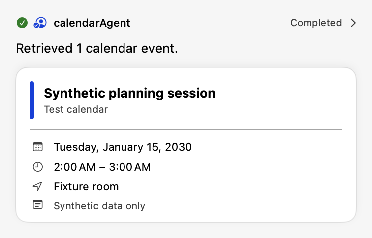
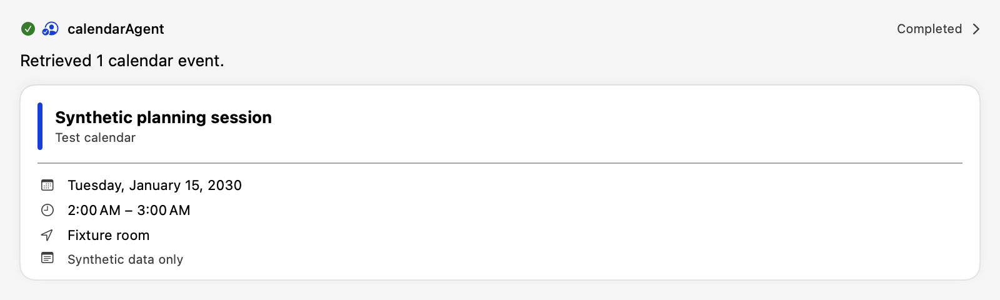

# Calendar results from native event snapshots

Calendar rich cards no longer depend on a model reconstructing native event fields.
Both Botsworth and the LangTools sample consume the same `CalendarAgentResponse`.
Their existing registry/renderer contracts are unchanged.

## Execution contract

- Calendar read/search/upcoming and create/update/delete callbacks return an internal,
  versioned `CalendarToolResult` JSON envelope containing native event snapshots.
  The delegate model receives this envelope instead of the old formatted prose.
- Each `CalendarAgent.execute` invocation owns a separate collector. It observes
  nested Calendar callback results, forwards the original events to the host, and
  finalizes the parent response before publishing successful completion.
- Native snapshots supply titles, dates, all-day flags, location, notes, calendar
  name and identifier. ISO 8601 timestamps use the existing card-compatible format.
  No dates, end times or flags are inferred from model prose.
- With native results, the final response contains those events and a deterministic
  summary—even if the model returns prose, fenced JSON, missing fields, or different
  event values. The model's final wording is deliberately not retained as the summary.
- Results from multiple queries are accumulated. Identifier plus start date identifies
  an occurrence, rather than collapsing a recurring series. Update/delete results
  remove the original occurrence; repeated reads replace rather than duplicate it.
  A broad query followed by a narrower query can therefore display both result sets.
- An empty successful query is authoritative and cannot turn model-invented events
  into cards. Existing zero-item behavior remains: no empty rich card is attached.
- Without native callback data, a decodable `CalendarAgentResponse` is retained
  byte-for-byte for compatibility. Invalid JSON/prose instead fails explicitly.
  This compatibility path is not independent evidence that model-authored events
  exist in the native calendar.
- Calendar delegate failures or malformed native envelopes prevent successful parent
  completion. Earlier mutations may already have succeeded; the error warns users to
  inspect tool results before retrying. Finalization does not retry any operation.
- Provider errors, missing/empty provider completion, and cancellation remain errors;
  collected events do not mask a failed provider run.

`Agent.execute(context:)` is a protocol requirement with the existing default
implementation. Specialized agents can call the normal loop with a throwing
`finalizingResponse` closure. Validation runs before the successful event and return,
including when the agent is invoked through a `LangToolsTool` wrapper.

## Disclosure, persistence and diagnostics

The canonical native response becomes the parent agent's result, disclosure and
replay payload. Nested callbacks retain their typed envelopes. The original parent
model completion is not separately persisted. Valid no-tool legacy responses keep
their original bytes. Public Calendar encoders include required nullable keys.

The existing rich/history settings still control attached versus standalone cards.
The Calendar collector does not introduce global result storage or preferences.
DEBUG logging adds only a fixed source label, event count and model-output shape.
No event payload, prompt, custom model name or arbitrary error text is added to logs.
The existing agent completion diagnostic describes the model output shape, but is
emitted only after finalization succeeds.

## Reproduction and verification

All automated scenarios use synthetic value-only query closures and an in-process
provider. Tests do not read native calendars, request permissions or access provider
credentials. They exercise the actual read callbacks, nested delegation, existential
and tool-wrapper dispatch, malformed/prose completions, mutation reconciliation,
concurrent invocation isolation, error/cancellation paths, and message attachment /
Codable reload. The mutation reconciliation tests use synthetic envelopes; they do
not execute EventKit writes. History-disabled output is checked for duplication.

```sh
LANGTOOLS_ENABLE_EXTENDED_TESTS=1 swift test --filter 'AgentsTests|RichResultDiagnosticsTests'

swift test --package-path Apps/LangTools \
  --filter 'CalendarExecutionResultsTests|CalendarRichResultPipelineTests|CalendarAgentSchemaTests'

CALENDAR_NATIVE_RESULT_ARTIFACT_DIR=/tmp/calendar-native-results \
  swift test --package-path Apps/LangTools --filter CalendarRichResultPipelineTests
```

The opt-in macOS capture uses the actual sample `CalendarEventCard.swift` through a
relative test-source symlink, plus the production invocation view/registry. It renders
375 pt and 800 pt widths and asserts visible synthetic text using OCR. These are native
macOS captures, not iOS-device or signed-in/live-provider verification.

## Synthetic native-result captures

| 375 points | 800 points |
|---|---|
|  |  |

Build the app from this source checkout before live verification; launching the
LangTools Helper alone does not rebuild either host app. The account-backed Codex
route still lacks app-agent tool execution and is explicitly outside this fix.
