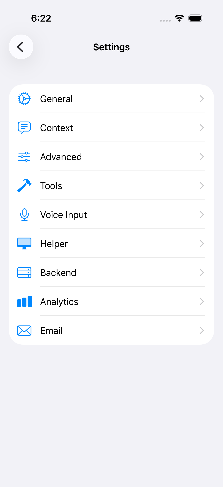
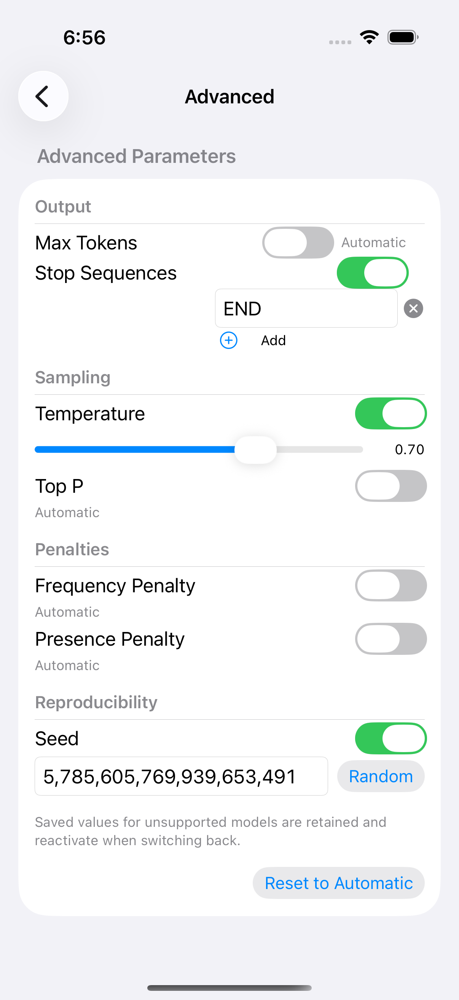

# iOS settings screenshots

Captured from the Botsworth iPhone 17 Pro / iOS 26.3.1 integration fixture.

Automated simulator screenshot comparisons live in the consuming Botsworth app:
`App/UITests/ProxyModelDiscoveryUITests.swift`, `testSettingsScreenshotBaselines`.
See [Botsworth MR !44](https://gitlab.com/rchatham/Botsworth/-/merge_requests/44)
for the baseline images, runtime contract, and verification results. This tests
these shared views inside their actual iOS NavigationStack and Form host.

## Automated review follow-up (2026-11-06)

The Ollama review on PR #91 was checked against the callers and tests:

- Kept secret-bearing `pull_request_target` reviews limited to `main`. Stacked
  PRs use the explicit manual dispatch; ordinary Swift CI still covers the helper
  base branch. Revalidate repository identity as well as head SHA before posting.
- Documented `ChatSettingsView` model ownership and its view-identity lifetime.
  The application constructs its model in a computed settings-view factory;
  retaining that first model prevents navigation reconstruction from losing edits.
  Callers replacing the model must give the settings view a new identity.
- The load guard deliberately survives submenu navigation. Unconditionally loading
  when the menu reappears caused the verified save/reload ordering regression.
  Saving on page exit also covers dismissing while a page is open; the menu save
  covers exit from the root. These writes are idempotent, so both are retained.
- Navigation, proxy filtering, persistence, accessibility IDs, and six screenshot
  comparisons are integration-tested in Botsworth's actual app host (linked above).
  This package does not supply an independent iOS XCUITest host for these screens.
- The test stub's `--jq` path is used by `pi-coding.yml`'s trusted-source check;
  it is shared by the coding and review workflow tests and is not dead code.
