# Public helper API presentation verification

Current production SwiftUI pairing modifier rendered and inspected on macOS 15.6, 2026-10-09. The AppKit fixture hosts a real attached sheet, not a replica of the pairing UI.

| Default title | Custom title | Invalid link |
|---|---|---|
| 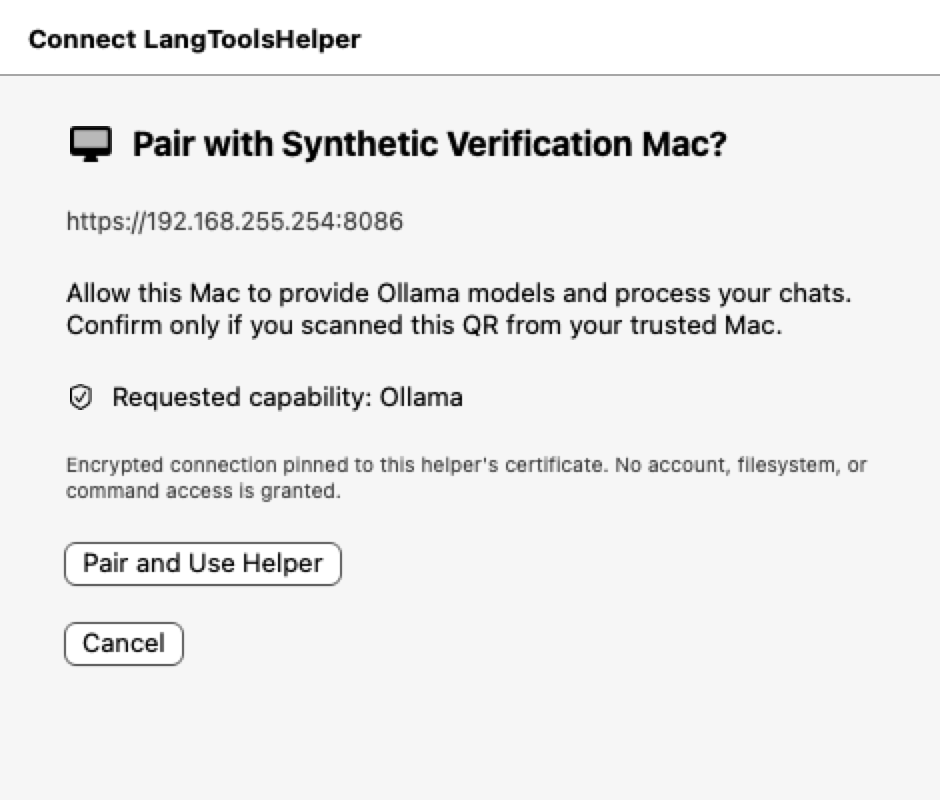 | 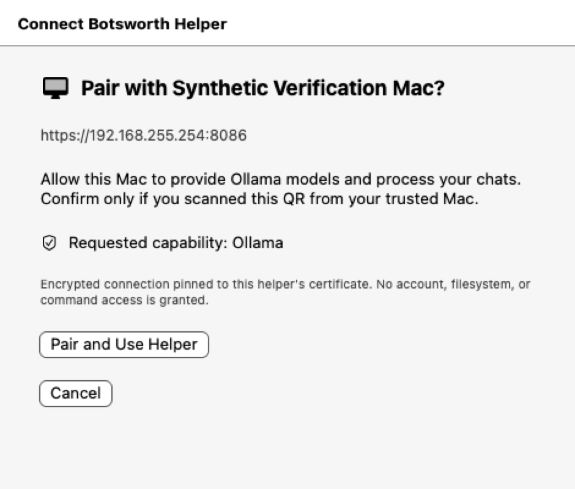 | 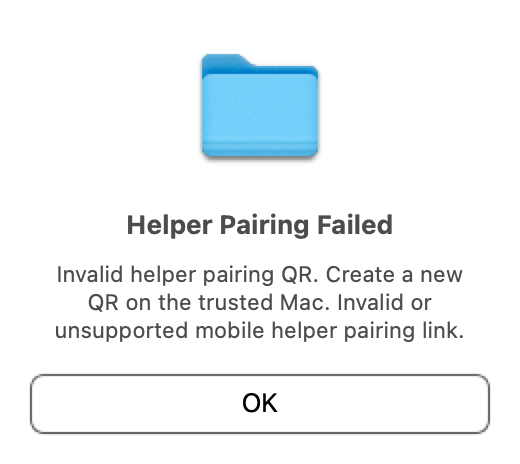 |

The titles, synthetic Mac identity/endpoint, complete consent/capability/security text and confirmation/Cancel controls are readable without clipping. Only the production Cancel button is pressed. The invalid-link alert is dismissed without pairing. Three tests verify sheet attachment, accessibility content, dismissal, unchanged configuration and zero selection callbacks.

```bash
MOBILE_HELPER_PRESENTATION_ARTIFACTS=/tmp/botsworth-phase1/presentation \
  swift test --package-path Apps/LangTools --jobs 4 --no-parallel \
  --filter MobileHelperPairingPresentationTests
```

Artifact-enabled and artifact-disabled runs each passed 3 tests, exit 0. The final combined helper/configuration/lifetime/TLS/presentation run passed 52 tests, exit 0. Logs: `/tmp/botsworth-phase1/{presentation-tests,presentation-no-artifacts,public-api-final-client}.log`.

## iOS production presentation — verified 2026-10-13

A dedicated, Debug-only SwiftUI app and XCUITest bundle under [`Tests/PublicHelperPresentationFixture/FixtureHost`](../../../Tests/PublicHelperPresentationFixture/FixtureHost/README.md) host the actual injected production modifier, independently of ordinary LangToolsApp startup. **Three tests passed on each of iPhone 17 and iPad (A16), iOS Simulator 26.3.1**, with no failures or skips. Runtime version and counts were checked in both `.xcresult` summaries, not inferred from the SDK version.

<table>
<tr><th>Viewport</th><th>Default title</th><th>Custom title</th><th>Invalid link</th></tr>
<tr><td>iPhone</td><td><a href="iphone-default-confirmation.png"></a></td><td><a href="iphone-custom-confirmation.png">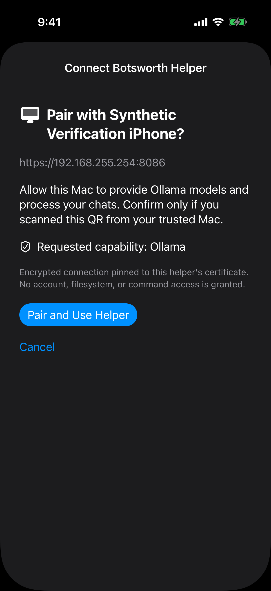</a></td><td><a href="iphone-invalid-link.png">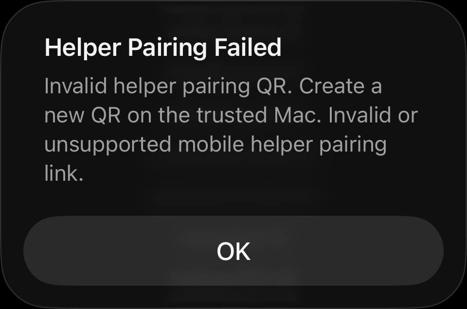</a></td></tr>
<tr><td>iPad</td><td><a href="ipad-default-confirmation.png">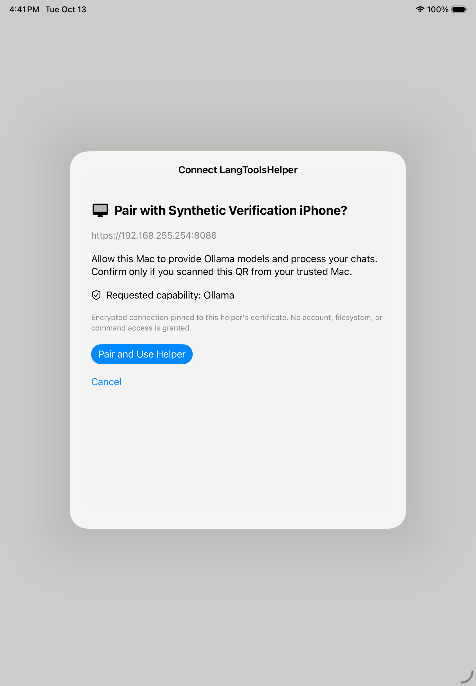</a></td><td><a href="ipad-custom-confirmation.png"></a></td><td><a href="ipad-invalid-link.png">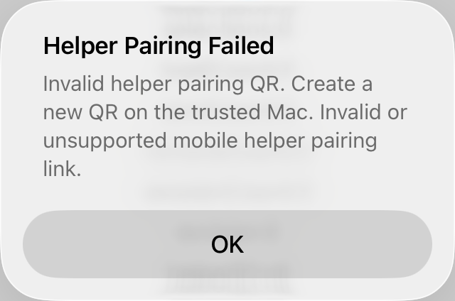</a></td></tr>
</table>

All six images were inspected: titles, endpoint, consent/capability/security text and controls are readable without clipping. Confirmation images are application screenshots; invalid-link images are native alert-element crops. XCUITest also retains `keepAlways` attachments. These are simulator captures, not physical-device or packaged Botsworth evidence. iPhone uses dark appearance; iPad uses light appearance.

Tests press only the real production Cancel or alert OK, then explicitly refresh fixture diagnostics and assert unchanged revision/helper selection, zero selection callbacks, zero credential-store operations and zero session-factory calls. In-memory storage and a deny-all URL protocol prevent real credential/network I/O even on an accidental Confirm tap. Missing/unknown scenario, wrong bundle, non-Debug build, failed defaults creation or inherited helper selection fail closed before configuration construction. `@testable` is limited to fixture dependency injection; ordinary-import API coverage remains in `PublicHelperAPISmoke`.

[Repeatable commands and setup](../../../Tests/PublicHelperPresentationFixture/FixtureHost/README.md). Final logs: `/tmp/langtools-pr78-fixes/test-xctest-{iphone,ipad}-parent.log`; result bundles: `results-xctest-{iphone,ipad}-parent.xcresult`; both runs exited 0. Earlier failed SPM-only harness attempts are retained under `/tmp/langtools-pr78-fixes/` and the superseded draft under `superseded-spm-draft/`; that attempted host did not mount SwiftUI modals on this setup. A dedicated app/UI-test lifecycle resolved it, without ordinary app startup or macro-trust bypass.

Independent read-only QA verified both result bundles and current source; fixture-safety review found no blocking issues. These are scoped reviews, not a security audit. The new iOS fixture is not wired into hosted CI.

## Tool-iteration-limit alert — verified 2026-10-27 UTC

The app now delegates only `LangToolsRequestError` presentation to the exhaustive
`chatAlertInfo` mapping in the compiled Chat package. Two direct tests preserve
all four existing titles/messages, including the localized tool-limit description
and absence of executable actions or credential fields. Hosted package CI selects
these tests explicitly; this does not replace a full executable-app build.

The shared, test-only `RequestErrorPresentationFixture` hosts **the actual ChatUI
composer/error handler** with an inert message service. It never constructs an
ordinary app service, voice handler, conversation, credential store or provider.
The real informational alert uses **Cancel**, not OK; no production UI behavior
was changed to make testing easier. Both native fixtures press that real control,
verify dismissal, one mapping and zero unexpected service operations. The iOS host
also refreshes diagnostics before capture and after dismissal and verifies zero
credential/session/selection effects and unchanged helper ID/revision.

<table>
<tr><th>macOS light</th><th>macOS dark</th><th>iPhone dark</th><th>iPad light</th></tr>
<tr><td><a href="macos-light-tool-iteration-limit.png">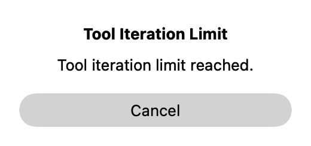</a></td><td><a href="macos-dark-tool-iteration-limit.png">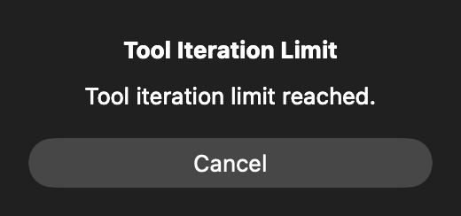</a></td><td><a href="iphone-tool-iteration-limit.png">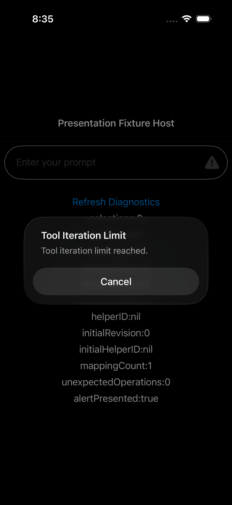</a></td><td><a href="ipad-tool-iteration-limit.png">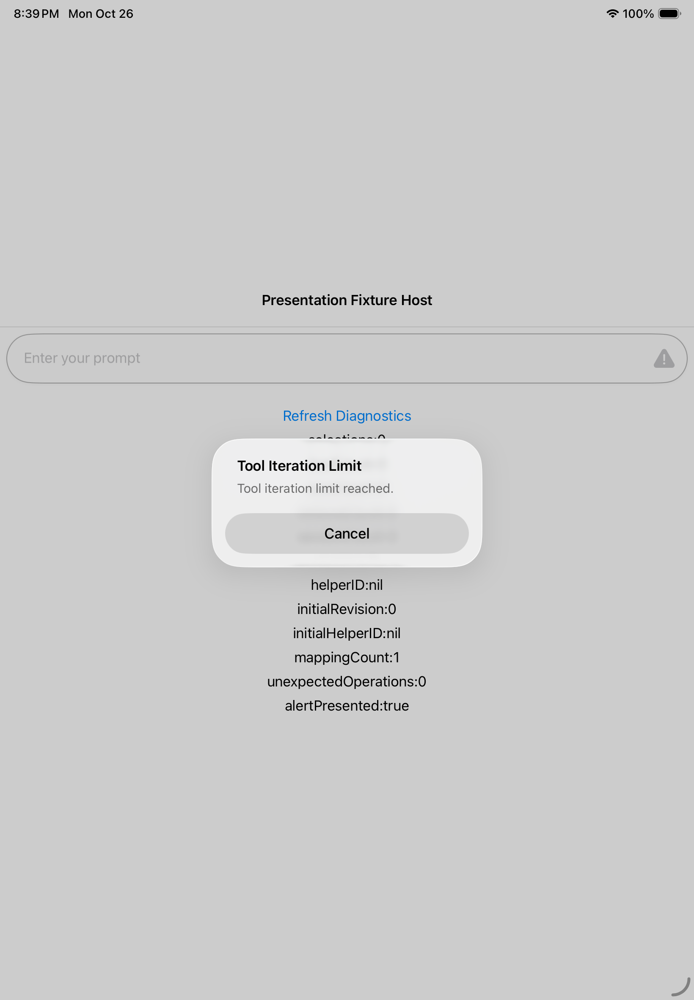</a></td></tr>
</table>

All four alert captures were inspected for readable, unclipped title, message and
Cancel. macOS captures draw the actual attached native view hierarchy with
`displayIgnoringOpacity`, over an appearance-resolved system background; they do
not reconstruct text or controls. Local Vision recognition validates all three
strings and pixel checks reject unresolved backgrounds. The original layer-only
attempt lost native drawing and was rejected, not accepted as visual evidence.
These content-view bitmaps do not verify window chrome, desktop blur or material
vibrancy. iOS captures are actual fixture-application screenshots, retained also
as `keepAlways` XCUITest attachments. No desktop/window-server capture or permission
changes were used.

Verification on macOS **27.0.1**, Xcode **26.3 (17C529)**, iOS Simulator **26.3.1**:

- Safe focused Chat run: **50 tests passed**, including two mapping cases and four
  AppKit presentation cases (the new tool-limit case covers light and dark).
- Native iOS fixture: **four tests passed per device**, iPhone 17 and iPad (A16),
  with no failures or skips; Debug `build-for-testing` also succeeded.
- Ordinary macOS app: unsigned compile+link **BUILD SUCCEEDED** after the owner's
  normal macro approval (see below); the app was not launched.
- HelperLink: **11 passed**; ordinary public-import smoke and CLI builds passed.
- Independent scoped correctness/security source reviews found no actionable
  findings; these were read-only reviews, not audits or independent test reruns.

Commands for macOS remain above; the iOS fixture README lists all four scenarios.
Current logs/results are retained under `/tmp/langtools-pr78-alert-fixes/`, notably
`app-final.log`, `iphone-final.{log,xcresult}`, `ipad-final.{log,xcresult}`,
`helperlink.log`, `smoke.log` and `cli.log`. The two unsafe shared-settings/real-
Keychain tests remain explicitly excluded. Focused counts overlap earlier runs;
they are not full-suite acceptance. Older pairing evidence above remains historical.

### Ordinary-app build verification

A fresh unsigned macOS app build initially exited **65** at macro validation:
`JSONMacroPlugin` from `JSON.swift` changed since its previous approval and must be
enabled. The clean checkout matches both root and app Xcode pins: JSON.swift
**1.0.4**, revision `498270c44bb80c5cf5b8de8727ceb030f95c0777`; SwiftSyntax is
**510.0.3**, revision `2bc86522d115234d1f588efe2bcb4ce4be8f8b82`.
The manifest, plugin entry point and schema-generation implementation were
inspected; this is not an audit or permission to execute untrusted code.

The owner reviewed that specific dependency and confirmed the project builds
normally in Xcode. Retrying the same compile-only `xcodebuild` command with the
project's normal DerivedData then produced **BUILD SUCCEEDED** for arm64/x86_64,
with resolved versions enforced from `Package.resolved`. The earlier failure was
specific to the throwaway `-derivedDataPath` checkout, whose macro approval state
was separate; it was not worked around. No global trust edit, validation-skip flag,
permission change or ordinary app launch was used.

Evidence (all retained):

- Failed: `/tmp/langtools-pr78-alert-fixes/mac-build.log` and
  `mac-build-after-approval.log` (exit 65, dedicated DerivedData).
- Succeeded: `/tmp/langtools-pr78-alert-fixes/mac-build-default-dd.log` (exit 0).

This verifies the executable app compiles and links with the new exhaustive
mapping delegate; it was not launched. The user's earlier GUI fixture error
remains unidentified without its first diagnostic.

## Boundaries

- Synthetic, non-redeemable payloads only; fresh UUID defaults suites and custom credential namespaces. An inherited selection is rejected before construction. No confirmation, Keychain I/O, network request or listener occurs.
- Default-title evidence uses an injected coordinator; the legacy no-argument `.shared` wiring is compile-checked and code-reviewed, not exercised at runtime.
- Images are attached-sheet content-view layer bitmaps at 2× with Aqua appearance and the actual window background color beneath compositor-backed materials. They are not full screen/compositor captures; shadow, material vibrancy and active-window accent fidelity are not verified. The alert's icon belongs to the test process, not a packaged application.
- The in-process accessibility hierarchy is enabled like the existing ChatUI harness. No cross-process accessibility or screenshot-permission changes are used.
- macOS 14 runtime, iOS 17 runtime and physical-device pairing remain unverified. At head `62376cc`, [hosted CI](https://github.com/rchatham/LangTools.swift/actions/runs/38007370392/job/114079158696) passed 126 app tests including all three AppKit presentation cases, with no skipped AppKit tests. The existing `MobileHelper` filter includes these cases. This confirms that run, not future heads or iOS rendering.
