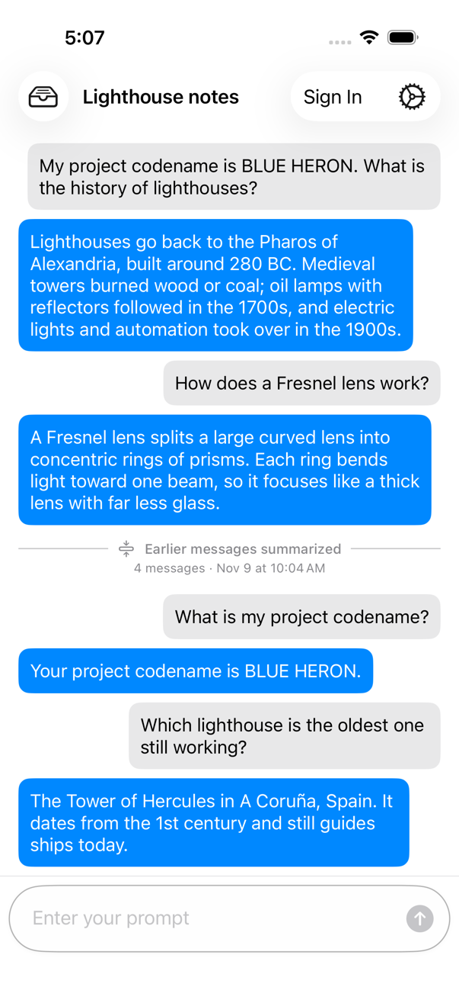
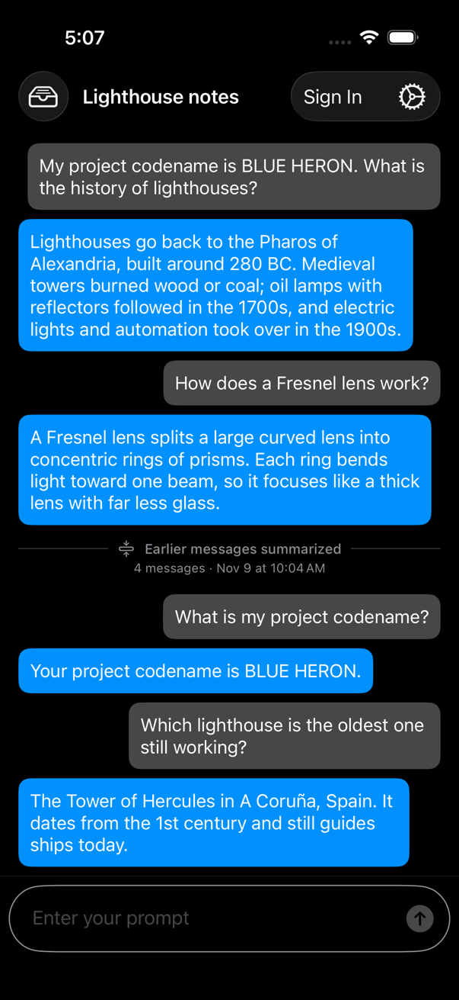
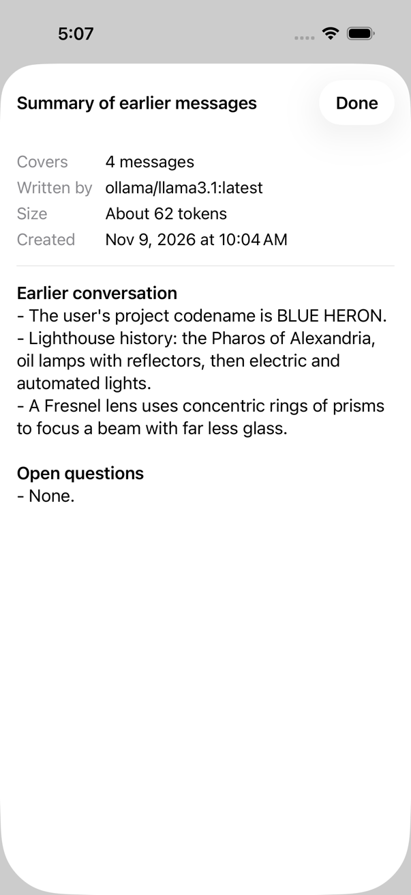
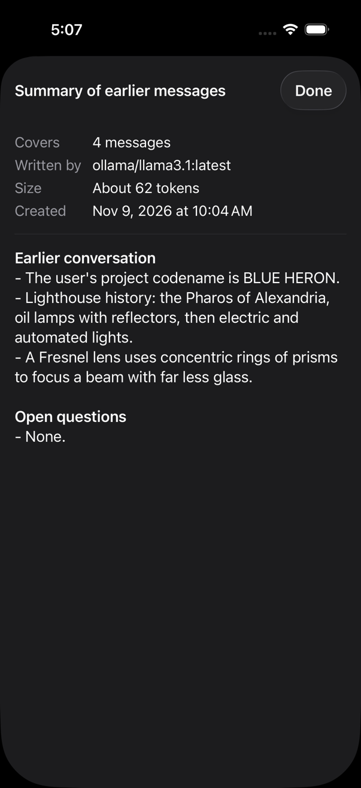
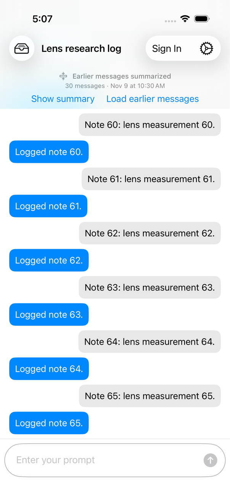
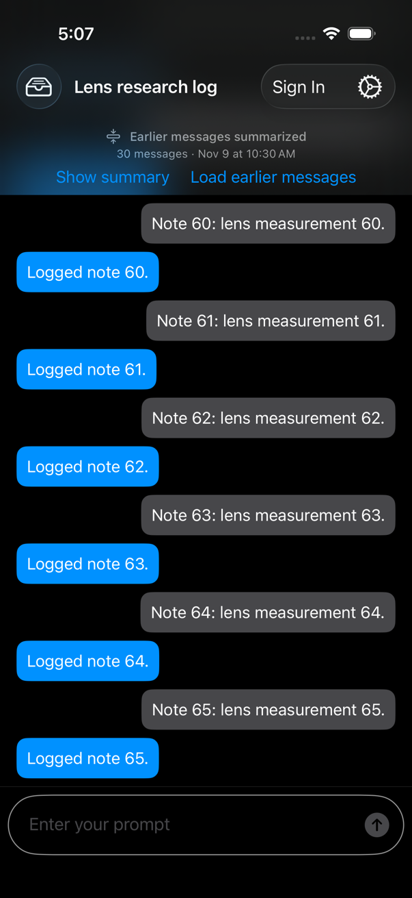

# Compaction markers in the transcript

`ChatHistory` shows where a conversation's older messages were summarized,
drawn from stored context checkpoints rather than inserted messages, so nothing
extra is sent to the model, saved as content or exported.

- `ChatCheckpointMarker`: a divider after the last summarized message, with the
  number of messages covered and when. Tapping it opens
  `ChatCheckpointSummaryView`: the summary, the model that wrote it ("Summarized
  without the model" for an extractive one) and its token estimate.
- `ChatSessionContextHeader`: "Summarizing earlier messages…" while a send waits
  for a summary, and, for a thread opened from a checkpoint, that checkpoint with
  "Show summary" and "Load earlier messages".

## Captures

Botsworth Debug build on an isolated iPhone 17 Pro simulator (iOS 26.3.1), from
`App/UITests/ContextCompactionUITests.swift` in Botsworth MR !48. The isolated
fixture seeds two conversations with stored checkpoints, so no model or network
is involved. Images are half the device resolution.

| | Light | Dark |
|---|---|---|
| Inline marker |  |  |
| Summary sheet |  |  |
| Thread opened from a checkpoint |  |  |

The live "Summarizing earlier messages…" state is covered by
`ChatSessionCheckpointTests.testACompactingSendShowsProgressThenItsMarker`; it
was not captured on screen.
